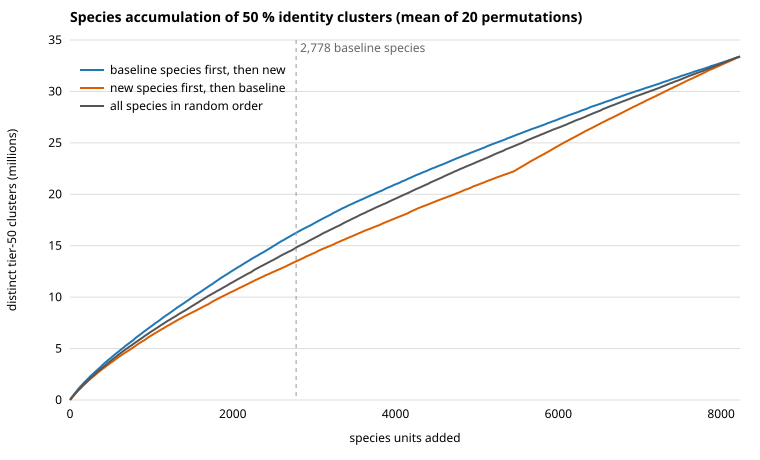

# Delta Gain: findings synthesis

Status: complete draft for collaborator review, 2026-11-08 (includes the species accumulation, secretome / copy-number and parameter-sensitivity analyses). Source of truth for every number is `docs/DELTA_GAIN_PLAN.md` (§11 status log) and
`docs/FAMILY_DIVERSITY_PLAN.md` (§10 status table). Scripts are in `bin/`, launchers in `launch/`, results under
`results/` of the `delta-gain-fungi` working directory (HPCC, `/bigdata/stajichlab/shared/projects/BFD/DeltaGain_Fungi`).
This file is the narrative; if it and the plans disagree, the plans win (they carry the job ids and exact settings).

## 1. The question and the short answer

> How much NEW protein-level information do newly annotated fungal genomes add, compared with what was already known from
> previously annotated fungal genomes, controlling for the many re-sequenced strains of the same species?

Baseline = 5,703 genomes with a prior NCBI annotation. New = 17,864 matched genomes without one (183.1 M proteins).
About 60 % of new genomes are strains of species already in the baseline.

**Short answer.**

1. **Whole-proteome view.** 50.2 / 29.2 / 22.4 % of new proteins fall in clusters with no baseline member at 95 / 70 / 50 % identity.
   That protein-weighted headline understates novelty per species and is dominated by heavily resequenced species. Counted once per species
   about 39 % of proteins are novel at 50 % identity, and the novelty comes from new species and genera, not from new strains.
2. **Strains add little.** Strains of baseline species are 60 % of new proteins but 36 % of the novel ones (13.3 % novel at 50 %,
   median genome 5 %). New species in a baseline genus are 27.6 % novel; new genus or higher 57-63 %.
3. **Most novel proteins are still homologs of known families.** Of the survivor clusters seen in 5 or more genomes, 79 % have a detectable
   baseline homolog by sensitive search; 10.7 % have none. Among all 12.2 M single-genome clusters 63 % have a homolog and 21 % none.
4. **Novel protein mass is species-restricted.** 82 % of survivor clusters (61 % of survivor proteins) come from one species.
5. **Within a family, new genomes add about what the same number of baseline genomes would.** For typical CAZy, MEROPS, random Pfam and
   secondary-metabolism backbone families the extra is about 1-3 percentage points. Pfam families chosen for being enriched in new genomes
   (mostly Saccharomycotina yeast families) show about +15 points, and that replicates in independent species.
6. **Unseen clades are not special.** New genomes from orders with no baseline genome are no more novel than a typical held-out baseline order
   (pooled and class-matched nulls, about -2 points at 70 %).
7. **Artefacts do not explain the result.** Predictor mismatch (NCBI vs BFD gene models) adds 1.5-3 points; contamination-flagged genomes supply 8.2 % of
   novel protein mass; annotated transposons about 1 %; there is no excess of prokaryote-like best hits among novel proteins.
8. **Novel family members are often degenerate or partial.** Novel GH18 and S08 regions are shorter and more often miss catalytic residues; novel
   S08 hits include probable carboxylase false hits. These are not evidence of new catalytic function.
9. **The fungal 50 % cluster pangenome is not saturated.** Adding species in random order, each further species still contributes about 2.7-4.5 thousand new clusters. A new species adds about five times more
   clusters per genome than a resequenced strain of a known species (about 1,870 vs 350).
10. **No secretome or expansion signal.** New genomes do not carry more signal peptides or small-secreted-protein candidates than same-order baseline genomes, survivors are not enriched for them, and
   CAZy/MEROPS copy number changes are small and balanced (19 families expand, 23 contract per 1,000 proteins).
11. **The family result is robust.** It does not change with coverage threshold, coverage mode or Pfam region definition (five families, sensitivity run).

## 2. Design in brief

| Element | What was done |
|---|---|
| Baseline / new | `genome_classes.tsv`: 5,703 baseline, 17,864 new matched genomes (196 not annotated and 2 ambiguous-tag genomes kept out of headline numbers). |
| Funnel | Nested MMseqs2 linclust over BASE (NCBI proteins) and NEW (BFD proteins) at 95 % (90 % cov), 70 % and 50 % identity (80 % bidirectional coverage). A new protein is novel at a tier if its cluster has no baseline member. Survivors = novel at 50 %. |
| Family walk | Regions of a Pfam / CAZy / MEROPS family (or subfamily) from the BFD re-annotation of **both** groups (no predictor confound), clustered inside the family at 90 / 70 / 50 / 30 %. Novel region = cluster with no baseline member. |
| Nulls | F3: equally many same-order baseline genomes (baseline-vs-baseline). F3b: leave one whole order out. F3c: class-matched version for orders with no baseline genome. Genome-level and species-collapsed variants, 200 draws. |
| Controls | Predictor control; rank decomposition; rarefaction to k genomes per species; size-matched random-Pfam control; species-half split-sample test; contamination/TE triage; quality (BUSCO, N50) within-order diagnostics. |
| Survivor characterisation | Pfam/CAZy/MEROPS labels, taxonomic breadth, sensitive MMseqs2 search (-s 6.0) against the 16.45 M baseline-known tier-50 representatives, profile search of no-hit clusters, Swiss-Prot taxonomy screen, ESMFold pilot. |

## 3. Whole-proteome funnel

### 3.1 Headline and spread

| Tier | Novel new proteins | Fraction |
|---|---:|---:|
| 95 % id / 90 % cov | 91,857,334 | 50.2 % |
| 70 % | 53,498,892 | 29.2 % |
| 50 % | 41,042,274 | 22.4 % |

Per genome (17,864 genomes) the median fraction novel is 35.6 / 14.1 / 10.2 % and the 90th percentile 99.5 / 82.1 / 62.0 %: the spread separates
strains of baseline species from new-taxon genomes.

### 3.2 What drives it: relatedness to the baseline (rank decomposition)

Novel at 50 % identity, by the lowest rank a new genome shares with a baseline genome:

| Stratum | Genomes | Fraction novel at 50 % | Share of novel proteins | Novel proteins per genome |
|---|---:|---:|---:|---:|
| Strain of baseline species | 10,673 | 13.3 % | 36 % | 1,374 |
| New species, baseline genus | 5,087 | 27.6 % | 35 % | 2,817 |
| New genus, baseline family | 1,629 | 57.0 % | 22 % | 5,652-6,351 |
| New family / order / class or higher | 475 together | 59.6-63.2 % | 7 % | 5,652-6,351 |

### 3.3 Controlling for resequencing

Rarefying to k random genomes per species (50 draws, protein-weighted), novel fraction at 95 / 70 / 50 %: k = 1 76.9 / 49.9 / 37.6; k = 2 74.6 / 47.5 / 35.8;
k = 5 70.5 / 44.0 / 33.1; k = 10 67.1 / 41.3 / 31.2; all genomes 50.2 / 29.2 / 22.4. One value per species (median over its genomes): 5,454 species, mean novel
78.7 / 52.4 / 39.4 %; the 4,632 species absent from the baseline 85.6 / 58.3 / 43.7 %. The per-species view (about 40 % at 50 %) is the better measure of added
sequence diversity.

### 3.3b Species accumulation of 50 % clusters (E4)

All 23,567 genomes with annotated proteins (237 M distinct genome x tier-50 cluster pairs, 33.4 M clusters) were grouped into species units: 2,778 baseline species, 822 new-genome groups of species that also have a
baseline genome (`N_known`, about 10.7 k mostly resequenced genomes) and 4,632 new species (`N_newsp`, about 7.2 k genomes). Units were added in random order (20 permutations per ordering) and each cluster was credited to the
first unit that contains it (`bin/accumulation.py`, `results/accumulation/`; figure `figures/E4_accumulation.svg`).

* **No saturation.** The curve is close to linear. After all 2,778 baseline species (16.25 M clusters) each further species still adds about 4.0-4.5 k clusters at the start of the new units (positions 2,776-3,200), declining
  only to about 2.7 k for the last 230 new species. The 50 % cluster pangenome of the fungal kingdom is open at this sampling depth.
* **Baseline-first ordering.** New units add 17.14 M clusters absent from the baseline (matches the 17.10 M survivor clusters counted independently; the small gap is clusters held only by genomes outside the two classes): 3.72 M from the
  822 resequenced-species groups (about 350 clusters per genome) and 13.42 M from the 4,632 new species (about 1,870 clusters per genome). Strains of known species add little per genome; new species add roughly five times more.
* **New-first ordering (contrast).** The first 2,778 random new species cover 13.5 M clusters, 17 % fewer than the 2,778 baseline species (16.2 M). The 5,454 new species together cover 22.2 M clusters, and the baseline still adds 11.2 M clusters
  after all new genomes (about 4.0 k per baseline species). The baseline therefore carries a large share of sequence space that the new genomes do not reproduce.
* **Caveat.** Baseline proteins are NCBI gene models and new proteins are BFD models, so cluster counts per species include the 1.5-3 point predictor effect and differences in proteome size and completeness; the curves describe species
  sampling of 50 % clusters, not new families (most clusters are small and lineage-restricted, see section 4).

### 3.4 Artefact checks

* **Predictor mismatch.** 300 baseline genomes scored as NCBI vs BFD annotations against the same 1,000-genome reference: novel fraction 57.3 -> 60.0 / 34.5 -> 35.8 / 25.7 -> 26.8 %
  (95 / 70 / 50 %). The gene-model difference inflates novelty by about 1.5-3 points.
* **Contamination and transposons.** Genomes with GC more than 8 points from their order median (1,067) or BUSCO < 50 (322) are 6-7 % of new genomes and give 8.2 % of
  novel protein mass. Annotated TE domains label about 1 % of survivor proteins.
* **Horizontal transfer / contamination screen.** Best Swiss-Prot hit of survivor representatives (metagenome-bin genomes excluded) is prokaryotic for 4.1-4.8 % of
  survivors vs 5.2 % of background proteins; at >= 40 % identity 1.0-1.3 % vs 1.3 %. No enrichment. This is a screen only (< 50 % of survivors have a Swiss-Prot hit; no phylogeny).

## 4. What the survivors are

### 4.1 Labels and breadth

17,095,910 survivor clusters (41.0 M proteins): 12.2 M seen in one genome, 4.86 M in two or more, 1.25 M in five or more, 184 k in 20 or more. Most still carry a known Pfam domain
(41.6 % single-genome, 51.2 % 2-4 genomes, 55.7 % 5-19, 35.9 % >= 20 genomes); the most frequent are protein kinase, MFS, Zn2Cys6 and cytochrome P450 domains, i.e. divergent members
of large families. CAZy and MEROPS label 1-2 %.

Taxonomic breadth: 82 % of clusters (61 % of proteins) come from a single species; only 3.04 M clusters span two or more species and 0.90 M span two or more genera. Among clusters in
5 or more genomes: 33 % one species, 42 % one genus, 16 % one family, 4 % one order, 5 % multi-order.

### 4.2 Sensitive search against the baseline-known clusters

Clusters (by cluster count) by genome-count class:

| Survivor class | Clusters searched | Homolog | Close, low identity | Distant | **No hit** |
|---|---:|---:|---:|---:|---:|
| 5 or more genomes | 1,254,423 | 79.3 % | 8.5 % | 1.6 % | **10.7 %** (133,599) |
| 2-4 genomes | 3,602,662 | 74.2 % | 11.1 % | 1.9 % | **12.8 %** (460,890) |
| 1 genome | 12,238,825 | 63.0 % | 12.8 % | 2.9 % | **21.3 %** (2,602,543) |

The no-hit share rises as the number of genomes falls, as expected if no-hit clusters are enriched for gene-model artefacts and recent lineage-specific genes. A profile search of the
133,599 no-hit clusters of the 5+ class (re-clustered at 30 % into 107,819 profile clusters) found baseline hits for 10.2 % of profile clusters (12.9 % of proteins);
2.14 M proteins remain without any detectable baseline homolog.

### 4.3 Structure pilot

ESMFold (single sequence) on 400 representatives of no-hit profile clusters vs 400 of profile clusters that did gain a baseline hit: mean pLDDT (0-1) 0.372 vs 0.440; share with pLDDT >= 0.5:
8.8 % vs 27.3 %; >= 0.7: 0.8 % vs 6.3 %. Novel no-hit proteins are predicted with lower confidence, but both sets are low and length differs (150 vs 190 aa), so this fits disorder,
orphan or spurious-model status without proving it. Not run at full scale.

### 4.4 Secretome and lineage-specific expansions (E7)

Species-level units (genomes of one species and class averaged), contrast within order (71 orders with at least 3 units of each class), permutation test inside orders. Details and thresholds: `docs/E7_RESULTS.md`.

* **Secretome.** Whole-proteome signal-peptide fraction is 7.64 % in new vs 7.71 % in baseline genomes; small-secreted-protein (SSP) candidates (signal peptide, <= 300 aa, >= 4 Cys, no GPI anchor, no transmembrane helix beyond a signal anchor)
  are 1.369 % vs 1.359 %. Within order, new genomes carry slightly fewer signal peptides (-0.14 points, p 0.0003) and SSP candidates (-0.04 points, p 0.0003); the effect comes from new species (-0.045 points), not from new strains of
  known species (+0.001, p 0.94). The SSP rule is a heuristic, not an effector call.
* **Survivors are not enriched for secreted proteins.** Observed / expected SSP among survivor representatives (expected from the same genome's rate): 0.88 (1 genome), 0.98 (2-4), 1.01 (5-19), 0.79 (20 or more); signal-peptide obs/exp 0.72-0.90.
* **Copy number.** For 323 CAZy and MEROPS families seen in at least 50 genomes, per 1,000 proteins, 19 families expand and 23 contract in new genomes (q < 0.05), with small effects (4-15 % relative for common families).
  On raw copies per genome 174 families appear contracted, but new proteomes are about 8 % smaller (10.2 k vs 11.1 k proteins), so the proteome-size-normalised comparison is the fair one.
  Lineage-specific expansion is not a general property of the new genomes. Counts are proteins with a hit, not independent duplications.

## 5. Family-level diversity

### 5.1 Do new genomes add more than the same number of baseline genomes?

F3 (order-matched baseline-vs-baseline null): across the pilot families, the wide run (340 CAZy, 174 MEROPS, 200 enriched Pfam; 717 families, 18.0 M regions) and the subfamily run (474
subfamilies), new genomes add about the same novelty as equally many same-order baseline genomes.

| Family set | New minus null at 70 % (points) | Notes |
|---|---:|---|
| CAZy families | +0.7 | CI wholly > 0 in 1.6 % of families, never < 0 |
| MEROPS families | +1.7 | CI wholly > 0 in 9.9 % |
| CAZy / MEROPS subfamilies | +0.4 / +1.6 | |
| Random Pfam control (size-matched) | +2.2 | 66 % of families positive |
| Secondary-metabolism backbone Pfams (10) | -1.3 to +2.3 | intervals span 0 except ketoreductase +0.9 |
| **Enriched Pfam (top 200 by enrichment)** | **+14.6 to +14.9** | 97-98 % positive; best case by construction |

* The family ranking (S08 > GH18 > AA9 > controls) is already present in the null: it reflects inherent family diversity, not the new genomes.
* The enrichment effect **replicates in independent species**: lists selected on half of the species and evaluated on the other half give +14.6 points vs +4.3 for random controls, so it is not a winner's-curse artefact.
  The enriched list is a Saccharomycotina yeast list; BUSCO of those orders is 75-80 %, so this is a lineage effect rather than a quality flag.

### 5.1b Sensitivity to clustering and region choices (E9)

Five families (GH18, S08, the ketosynthase PF00109, one enriched Pfam PF10450, one random-control Pfam PF01568) were re-clustered and re-nulled (1,010 genomes per side, 200 draws) with later-tier coverage 60 / 80 / 90 %,
target-only instead of bidirectional coverage, and Pfam regions by alignment span instead of envelope (Pfam families only; CAZy and MEROPS have one span definition). The 30 % tier is already a default tier. Details: `docs/E9_RESULTS.md`.

* **The family-level result is insensitive to these choices.** New minus null at 70 %: GH18 +0.010, S08 +0.004, PF00109 0.000, control +0.001, with variants differing from the default by at most 0.004-0.007, far inside the null intervals.
* **The enriched family keeps its excess in every variant**: PF10450 +0.095 to +0.101 at 70 % (intervals exclude 0 in all five variants) and +0.065 to +0.074 at 50 %, so the enrichment is not an artefact of one clustering setting.
* **The 30 % tier adds no signal**: all differences within +-0.02 with intervals spanning 0. Across 15 family x tier cells there is one sign flip, PF10450 at 30 % with alignment-span regions (-0.007 vs +0.018), with every interval spanning 0.
* **Limits:** five families, small families (4-6 k regions) have wide intervals, and only clustering and region definition were varied (not the search sensitivity, the first-tier coverage, the null design or upstream annotation thresholds).

### 5.2 Unseen clades

Leave-one-order-out (F3b): holding out a whole order is far more novel than the within-order null (c70 median 60-85 % for the diverse families), but new genomes from orders with no baseline genome are **not**
more novel than a typical held-out baseline order (CAZy/MEROPS c70 -6.8 / -6.4 points pooled; class-matched F3c -1.9 / -1.9 / -1.0 points for CAZy / MEROPS / Pfam). The family-level novelty of new taxa is what sampling any
unseen clade gives, not a special property of these genomes. Caveat: only four classes allow the class-matched test, with 5 genomes per draw.

### 5.3 Where the novelty sits

Novelty is clade-specific, not family-wide: GH18 is 7.0 % novel overall but 2.9 % in Hypocreales and 2.1 % in Eurotiales vs 72.8 % in Ascoideales, 34.4 % in Pichiales and 23.0 % in Boletales; S08 is 5.0 % in Hypocreales
vs 31.1 % in Agaricales. New diversity concentrates where baseline sampling is thin. Baseline-free clusters are small (1.5-1.7 species on average).

Quality: raw novelty is 2-3x higher in BUSCO < 95 / N50 < 50 kb genomes, but within the same order the gap is only +2 to +5 points, so it is mostly clade composition. The top species supplies a small share of novel
regions (median 0.02-0.07).

### 5.4 Are novel family members functional? (GH18, S08)

Alignment to the Pfam profile with catalytic sites read from the HMM consensus (c70 clusters):

| Family | Group | Regions | Cover all sites | All canonical | Canonical, given coverage |
|---|---|---:|---:|---:|---:|
| GH18 | baseline | 65,500 | 97.6 % | 83.5 % | 85.5 % |
| GH18 | new, known cluster | 175,122 | 98.2 % | 84.2 % | 85.8 % |
| GH18 | new, novel cluster | 13,169 | 93.1 % | 74.4 % | 79.8 % |
| S08 | baseline | 64,787 | 90.9 % | 66.8 % | 73.5 % |
| S08 | new, known cluster | 183,064 | 93.6 % | 70.3 % | 75.1 % |
| S08 | new, novel cluster | 17,126 | 70.2 % | 44.8 % | 63.9 % |

Most of the deficit is truncation (30 % of novel S08 regions lack a catalytic site vs 6-9 %); among spanning regions novel ones are 6-10 points less often fully canonical. About 46 % of S08 regions with
carboxylase-type co-domains are novel and are probably MEROPS false hits. The His position of S08 is only 74-75 % canonical even in the baseline, so use it for relative comparison only.

## 6. Lifestyle correlates

FungalTraits 1.2 genus labels (Põlme et al. 2020) cover 1,061 of 1,204 genera with a new genome (16,085 of 17,865 genomes). Unit = genus; within-order deviation in novel fraction at 50 %, permutation test
inside orders. All genomes: mycorrhizal +4.4 points, saprotroph +1.2, plant pathogen -3.9, animal-associated -2.8 (n.s.), yeast growth form -4.1. Holding relatedness fixed, only mycorrhizal remains
(+7.5 points among new species in a baseline genus; +2.0 among new genera or higher); plant pathogens stay at -3.0 among distant genomes. Most lifestyle differences are sampling depth and relatedness, and
lifestyle is nested in clade, so this is a screen, not a causal result.

## 7. Limitations

* **Baseline definition.** "Baseline" is "had a prior NCBI annotation". It is a sampling, not a knowledge, boundary: the baseline is enriched for model organisms and well-sampled clades.
* **Strain pseudo-replication.** Handled by rarefaction, species-collapsed variants and genus-level units, but any protein-weighted number is dominated by heavily resequenced species.
* **Predictor.** The funnel mixes NCBI baseline proteins with BFD new proteins (1.5-3 points); the family walk uses BFD annotation for both groups and avoids this.
* **Selection.** The enriched Pfam list is selected on the outcome; it is a candidate list, not a genome-wide estimate.
* **Family nulls** only cover orders present in both groups; the clade-matched F3c has few classes.
* **Labels and searches** use cluster representatives; sensitive-search hits indicate homology, not function. No-hit clusters are a mix of orphan genes and gene-model artefacts that this work cannot separate.
* **Proxies.** The HGT screen (Swiss-Prot taxonomy) and the BGC-backbone analysis (domain level) are cheaper stand-ins for a phylogeny-based HGT analysis and for antiSMASH.

## 8. Not done (by decision, given the 2026-11-10 shutdown)

* antiSMASH on all genomes (replaced by the backbone-Pfam proxy).
* Phylogeny-based horizontal gene transfer screen (replaced by the Swiss-Prot taxonomy proxy).
* Full-scale structure prediction and structure-database search of the ~97 k no-hit profile clusters (replaced by the 400 + 400 ESMFold pilot; the representative list is `results/nohit_profile/profile_clusters.tsv`).
* F3c per-order ranking; sibling-flag list for the 57 strains with several assemblies; date-ordered addition curve.

## 9. Planned items and where they are

| Item | Status | Where |
|---|---|---|
| Funnel (95/70/50) | done | §3 |
| Predictor control, rank decomposition, rarefaction | done | §3.2-3.4 |
| Family census, extraction, clustering, F3/F3b/F3c nulls | done (717 families + 474 subfamilies) | §5.1-5.2 |
| Random-Pfam control, split-sample test | done | §5.1 |
| Quality / artefact diagnostics, deep dives | done | §5.3 |
| Survivor labels, breadth, triage | done | §4.1, §3.4 |
| Sensitive search of all survivor classes, profile search | done | §4.2 |
| Catalytic-residue (alignment) and architecture analysis | done for GH18 and S08 | §5.4 |
| Lifestyle correlates | done | §6 |
| BGC-backbone proxy, HGT screen, structure pilot | done as approved substitutes | §3.4, §4.3, §5.1 |
| Species accumulation (E4) | done (`bin/accumulation.py`) | §3.3b |
| Lineage expansions and secretome / SSP (E7) | done (commit bef178f) | §4.4 |
| Parameter sensitivity (E9) | done (commit 65d0ad0) | §5.1b |
| antiSMASH, phylogeny-based HGT, full structure prediction | out of scope | §8 |
